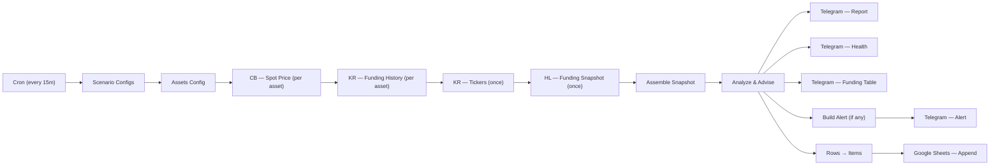

# Architecture

- The nodes run as one chain, so every fetch has finished before **Assemble Snapshot** reads them with
  `$('Node name').all()`. Per-asset responses are matched to assets by item index. The fetch nodes use
  "continue on error", so a failed request still yields an item and the indexes stay aligned.
- **Scenario Configs** is on the execution path. (In the 2025-08 version it was not connected, so edits
  to it had no effect.)
- **Assemble Snapshot** parses responses, keeps the last 800 funding prints per asset and outputs one
  item: `{ timestamp, assets[], hl{}, dated[] }`.
- **Analyze & Advise** turns the snapshot into `message`, `health`, `healthPrices`, `alert`, `rows`.
- Both nodes embed `src/core.js`. n8n Code nodes cannot import local files, so
  `scripts/build-workflow.js` inlines the core into each node. Edit `src/`, then run `npm run build`.
- Messages are cut at a line boundary below Telegram's 4096-character limit, and an open `<pre>` is closed.

## Why 15 minutes

Kraken funding changes hourly and each history response is about 1 MB per asset. Polling every 2 minutes
downloaded the same data 30 times an hour.
